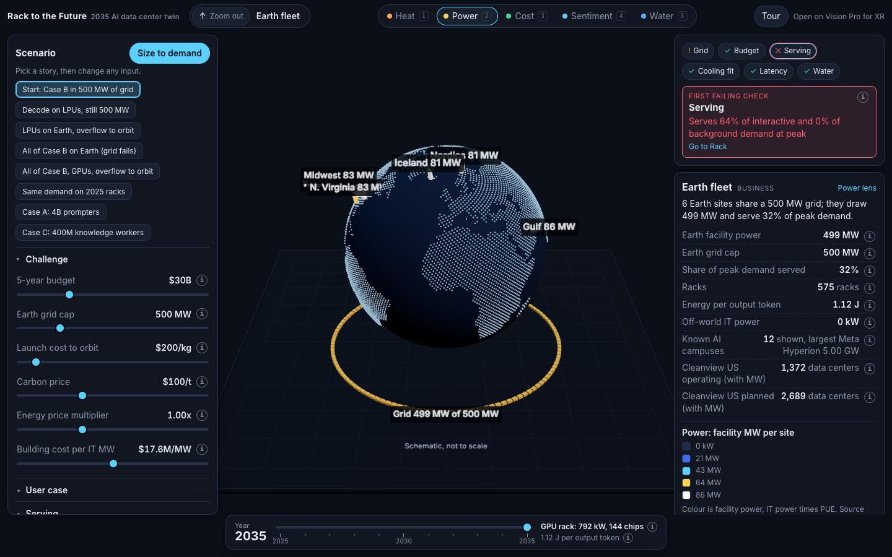

# Rack to the Future

**A multi-scale digital twin of the 2035 AI data center.** Zoom from one chip to a rack, a hall, a building, a site, the Earth fleet and into orbit. Switch lenses for heat, power, cost, public sentiment and water at every scale; each lens recolours the scene or says it does not apply at that scale. Slide from 2025 racks to 2035 projections, move the budget and grid limits, and watch the first constraint break. Every number in the panels names its source.

- **Open the twin:** https://wilsonwu-ai.github.io/Terawatt/web/ (any modern browser; on Apple Vision Pro tap Enter VR), or run `npm run serve` in this folder and open http://localhost:8145. Opening index.html straight from disk will not load the ES modules.
- **Read the PRD (STAR form):** [`prd/index.html`](prd/index.html), with ELI5 figures, diagrams and a [42-second motion explainer](prd/motion/index.html)
- Built at Sundai Hack 145 by Wilson Wu, from the Rack to the Future idea and technical spec by Jason Morris and Hunter Harris. Sundai Hack 145 ran at MIT on 18 October 2026 (Track 1).
- Rack, chip and orbit pictures in the level card are renders of the matching props from [RealityHD](https://github.com/hunterh37/RealityHD), the procedural prop library behind the Terawatt visionOS app, used under its MIT licence (`assets/realityhd/LICENSE`).



## S: Situation

Sundai Hack 145, Track 1, asked for the AI data center of 2035: a digital twin from power generation to compute to cooling, tuned to minimise energy per token. The setting is fixed for every team: a $30B five-year budget, 500 MW of Earth grid power across all sites, launch to orbit at $200/kg, and three user cases (4B prompters, 50M agent developers, 400M knowledge workers). Racks are heading from 132 kW (GB200 NVL72, 2025) to 600 kW (2027) and 792 kW (the 2035 GPU rack).

## T: Task

Make the trade-offs visible to three people at once: a planner deciding where and what to build, an engineer checking that it can be cooled and served, and a judge or member of the public who has 10 seconds. Two modules came out of the design discussion:

1. **Business, map first:** pick a region, see its power price, carbon, water and sentiment, size the facility, see a ghost building, follow the money, read NPV, IRR, payback and the break-even price, project to 2035, and see the existing data centers around it.
2. **Engineering:** a chip workbench (stack dies and HBM, watch power flow and heat), racks that rise from the table, a schematic tabletop hall (not to scale), and a life-size view in XR.

## A: Action

One data model drawn at seven scales:

```
scenario (sliders, presets)  ->  engine.derive()  ->  metrics  ->  7 level scenes + panels + XR
```

- **Engine** (`src/engine/engine.js`, pure functions, no DOM): demand from the slide 10 workloads and slide 11 cases, rack catalog by year, placement across six Earth sites under the grid cap, overflow to orbit, PUE from the slide 15 cooling table, serving with latency rules (Moon and Mars take background work only), five-year cost, NPV, IRR, payback, the break-even price per user per month, and six constraint checks in a fixed order.
- **Scenes** (`src/levels/*.js`): chip, rack, hall, building, site, Earth fleet, off-world. Each one implements the same small interface (`src/contract.js`) so lenses, readouts and picking work everywhere.
- **Panels** (`src/ui/`): breadcrumb, lens switch, year slider, scenario controls generated from the engine's parameter list, the constraint banner (tap the first failing check to zoom to its cause), the level card, and the business panel (break-even, returns, money flow, site constraints, facility size, 2025 to 2035 projection, existing data centers).
- **XR** (`src/xr/`): WebXR session on Vision Pro; the table appears at desk height, pinch to zoom in, an in-world panel switches lens, year and preset, and a life-size toggle.
- **Sources** (`src/data/sources.js`): 80 entries, each a slide, the spec, the Terawatt app engine, a published page checked with curl against the raw source, a formula, or an assumption with its reason. Tap any "i" in the app.

## R: Result

Engine output for Case B (50M agent developers) in 2035. Run `node scripts/presets-table.mjs` (or `npm run presets`) to reproduce every figure; it writes `test-results/presets.json`.

| Scenario (preset) | Racks | Earth power | Orbit IT | 5-year cost | Peak demand served | Energy per output token | Break-even per user per month | First failing check |
|---|---:|---:|---:|---:|---:|---:|---:|---|
| Case B in 500 MW (start) | 575 | 499 MW | 0 | $23.6B | 32% | 1.12 J | $34.45 | Serving |
| Decode on LPUs | 635 | 499 MW | 0 | $23.3B | 48% | 0.75 J | $22.91 | Serving |
| LPUs, overflow to orbit | 1,327 | 496 MW | 499 MW | $39.7B | 97% | 0.73 J | $19.66 | Budget |
| All of Case B on Earth | 1,790 | 1,554 MW | 0 | $73.3B | 100% | 1.12 J | $34.47 | Grid |
| Case B's 2035 demand on 2025 racks | 27,651 | 4,001 MW | 0 | $189.7B | 100% | 2.88 J | $89.20 | Grid |

What this says: the grid binds long before the budget does. LPU decode racks cut the energy per output token by a third (1.12 J to 0.75 J). Orbit can take the overflow, but then the budget binds. Agent developers would have to pay about $20 to $35 a month for five years just to cover the build.

## Run it

Run these from this folder (in the Terawatt repo that is the `web/` folder).

```bash
npm run serve          # python3 -m http.server 8145, then open http://localhost:8145
npm test               # engine and source tests (node 20+)
npm run presets        # every preset through the engine, writes test-results/presets.json

# browser tests: need playwright-core and a local Chromium
PLAYWRIGHT_CORE=/path/to/playwright-core CHROME=/path/to/chromium node tests/e2e/smoke.mjs
# XR test: also needs IWER, Meta's Immersive Web Emulation Runtime build
PLAYWRIGHT_CORE=/path/to/playwright-core CHROME=/path/to/chromium IWER=/path/to/iwer.min.js node tests/e2e/xr.mjs
```

No build step, no dependencies: three.js r186 is vendored in `vendor/three`. The browser tests (`tests/e2e/smoke.mjs`, `tests/e2e/xr.mjs`) use playwright-core with a local Chromium.

## Repo map

| Path | What |
|---|---|
| `index.html`, `src/main.js` | App shell, state, navigation |
| `src/contract.js` | Interfaces every module codes against |
| `src/engine/` | Model and finance (NPV, IRR, payback) |
| `src/data/` | Catalog, sources, sentiment, existing data centers, land outline |
| `src/levels/` | The seven scales |
| `src/ui/` | Panels and the business view |
| `src/xr/` | WebXR for Vision Pro |
| `assets/realityhd/` | RealityHD prop renders (MIT) shown in the level card |
| `prd/` | The PRD in STAR form, figures and the motion explainer |
| `tests/` | Engine, source and browser tests |

## Honesty notes

- Geometry is schematic. Numbers are not.
- Cleanview's US map (1,372 operating and 2,689 planned data centers with reported capacity) is credited and linked; its marker data is not redistributed here.
- Sentiment is one recent local news article per site with a stance we labelled. A sample, not a poll.
- Token and subscription prices are 2026 list prices, not 2035 forecasts. The break-even price needs no price assumption at all.
- Building cost uses Cushman & Wakefield's 2026 guide ($17.6M per MW); the Terawatt app engine uses $11M per MW, and the slider covers both.

## License

MIT. See [LICENSE](LICENSE).
